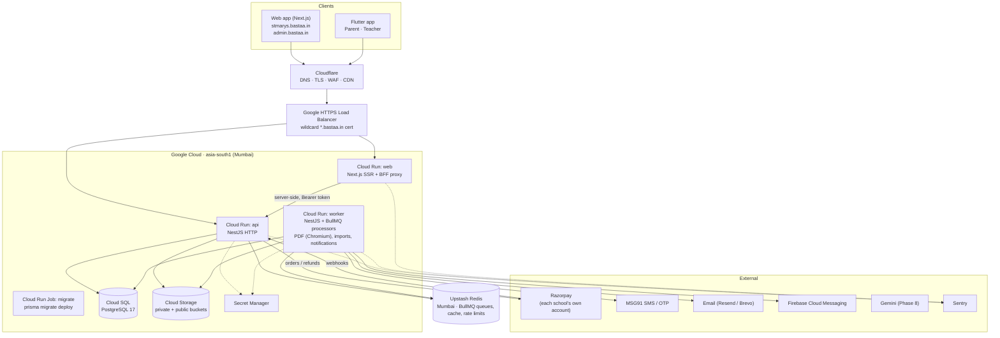
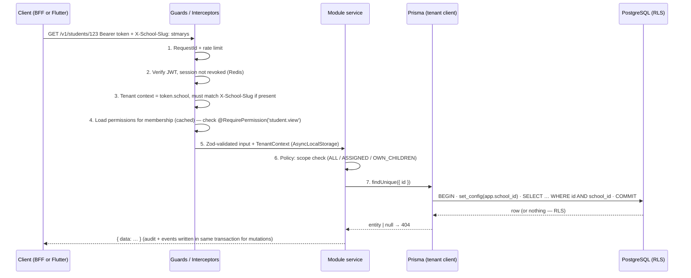

# 01 — System Architecture

## 1. Shape of the system

One codebase, one database, many schools. A **modular monolith** (NestJS) serves both the web app and the
Flutter app. Long-running work is pushed to a **worker** process that runs the same code with a different
entrypoint.



### Why this shape

| Choice | Reason | Exit path when we outgrow it |
|---|---|---|
| Modular monolith | One deploy, one DB transaction across modules, fastest for a solo developer | Modules talk through service interfaces + domain events, so a module (e.g. `notifications`) can be lifted into its own service later |
| Separate `worker` service | API stays fast; PDF/Chromium and bulk imports don't steal API CPU; scales independently | Split worker into several queues/services by workload |
| Web BFF proxy | Browser keeps tokens in **httpOnly host-only cookies** per school subdomain; no CORS; API only ever sees Bearer tokens (same as mobile) | — |
| Cloud Run | Pay per use, zero server admin, container based | GKE only if we ever need it (not expected for years) |
| Upstash Redis | ~$10/month fixed vs ~$35–50 idle Memorystore | Move to Memorystore by changing one connection string |

## 2. Monorepo layout

```
schoolerp/                      (pnpm workspace + Turborepo)
├── apps/
│   ├── web/                    Next.js 16 (App Router) — school web app + super admin
│   │   ├── app/(auth)/…        login, OTP, reset, school picker
│   │   ├── app/(school)/…      tenant app shell: dashboard, students, fees …
│   │   ├── app/(platform)/…    super admin (only served on admin.bastaa.in)
│   │   └── app/api/[...path]/  BFF proxy → api (adds Bearer token from cookie, refreshes)
│   ├── api/                    NestJS 12
│   │   ├── src/main.ts         HTTP entrypoint
│   │   ├── src/worker.ts       BullMQ entrypoint (same modules, no HTTP)
│   │   ├── src/core/           tenancy, auth guard, permissions, prisma, errors, audit, outbox, storage, queue
│   │   ├── src/modules/<name>/ one folder per business module (see §3)
│   │   ├── prisma/             schema.prisma, migrations/, sql/ (RLS policies), seed/
│   │   └── test/               e2e + tenant-isolation suites
│   └── mobile/                 Flutter (Phase 7) — parent + teacher in one app, role-based home
├── packages/
│   ├── contracts/              Zod schemas + TS types for every request/response (shared by web & api;
│   │                           generates OpenAPI → Dart client for Flutter)
│   ├── permissions/            permission keys + default role templates (single source of truth)
│   ├── ui/                     design system (React + Tailwind + Radix primitives)
│   ├── design-tokens/          tokens.json → Tailwind preset + Flutter ThemeData generator
│   └── config/                 eslint, tsconfig, prettier presets
├── infra/                      gcloud/bootstrap scripts, Cloud Run service YAMLs, LB setup notes
├── docs/                       this planning pack + runbooks/
└── .github/workflows/          CI/CD
```

Rules:
- `apps/*` may import `packages/*`; packages never import apps.
- `packages/contracts` is the **only** place request/response shapes are defined. Web forms (React Hook Form +
  `zodResolver`) and API validation use the same schema object.
- No shared runtime state between web and api other than HTTP.

## 3. Backend modules

Every module = `controller` (HTTP) + `service` (business rules) + `repository` (Prisma, tenant-scoped) +
optional `processor` (BullMQ) + `policy` (scope checks, see 04).

| Layer | Modules |
|---|---|
| **core** (not business) | `tenancy`, `auth`, `permissions`, `prisma`, `audit`, `outbox`, `storage`, `queue`, `errors`, `idempotency`, `entitlements`, `health` |
| **platform** | `schools` (tenants), `subscriptions`, `feature-flags`, `platform-admin`, `support-access` |
| **identity** | `users`, `memberships`, `roles`, `sessions` |
| **school setup** | `academic-years`, `classes` (+sections), `subjects`, `settings`, `branding`, `onboarding` |
| **people** | `students` (+enrollments, promotion), `guardians`, `teachers` |
| **daily ops** | `attendance`, `homework`, `timetable`, `notices` |
| **academics** | `exams`, `marks`, `results`, `report-cards`, `grading` |
| **finance** | `fees` (heads, structures, concessions, late fees), `invoices`, `payments`, `gateways` (Razorpay adapter), `receipts`, `refunds` |
| **platform services** | `notifications` (engine + channels), `documents`, `files`, `imports`, `reports`, `search`, `dashboard` |
| **ai** (Phase 8) | `ai` (tool registry, Gemini adapter) |

Module communication rules:
1. A module may call another module's **exported service**, never its repository or tables.
2. Side effects that other modules care about are published as **domain events**
   (`attendance.marked`, `payment.captured`, `results.published`, …) through the **outbox** (§5).
3. The notification engine, audit log, and search index listen to events — feature modules never send SMS/push
   themselves.

## 4. Request lifecycle (API)



Details in [03-multi-tenancy.md](03-multi-tenancy.md) and [04-rbac.md](04-rbac.md).

## 5. Background jobs & the outbox

Problem: "save the payment, then enqueue the receipt job" can fail between the two steps and lose the receipt.

Solution: **transactional outbox**.

```
API transaction ─┬─ INSERT payment
                 ├─ INSERT audit_log
                 └─ INSERT outbox_event('payment.captured', {paymentId})
            COMMIT
After commit:     try enqueue to BullMQ immediately (fast path)
Every 30 s:       outbox relay (in worker) re-enqueues events still PENDING (safety net)
Processor:        idempotent — keyed by outbox event id, safe to run twice
```

Queues (BullMQ, one Redis):

| Queue | Jobs | Concurrency | Retries |
|---|---|---|---|
| `notifications` | fan-out event → recipients → per-channel jobs | 10 | 5, exponential |
| `channel-push` / `channel-sms` / `channel-email` | provider calls | 20 / 5 / 10 | 5, exponential, then DLQ |
| `documents` | PDF: receipts, report cards (Chromium) | 2 | 3 |
| `imports` | parse → validate → commit Excel/CSV | 1 per school | 1 (user re-runs) |
| `reports` | async exports (PDF/XLSX/CSV) | 2 | 2 |
| `payments` | reconcile pending orders, refund status sync | 2 | 5 |
| `scheduled` | repeatable: fee reminders, overdue late fees, scheduled notices, outbox relay, cleanup | 1 | — |

Rules:
- **Job payloads carry IDs only** (no names, phones, marks). Redis is outside GCP, so no personal data goes there.
- Every job carries `schoolId`; the processor opens the same tenant context as an HTTP request.
- Failed jobs after max retries land in a dead-letter list surfaced in Super Admin → System.

## 6. Web app architecture

- Next.js App Router, **server components for page shells**, client components for interactive tables/forms.
- Data fetching: TanStack Query against the same-origin BFF (`/api/...`). Server components may prefetch and
  hydrate.
- Tenant resolution in Next.js `middleware`: read `Host` → slug → fetch public branding
  (`GET /v1/public/schools/:slug`, cached 5 min) → inject accent colour CSS variable + logo.
- `admin.bastaa.in` renders only the `(platform)` route group; school hosts never render it.
- `app.bastaa.in` = "Find your school" page (search by school name/code → redirect to its subdomain).

## 7. Mobile architecture (Phase 7, planned now)

- One Flutter app, two experiences (Parent / Teacher) chosen by membership roles; a user who is both sees a switcher.
- No subdomain on mobile: login → list memberships → pick school → school-scoped token.
- API client generated from OpenAPI (`packages/contracts` → `openapi.json` → `dart-dio` client).
- State: Riverpod; local store: Drift (SQLite) for the offline attendance queue and cached "today" data.
- Push: FCM (Android + iOS via APNs).
- Forced-update gate via `GET /v1/app/config` (min supported version).

## 8. Cross-cutting conventions

| Concern | Convention |
|---|---|
| IDs | UUID v7 (time-ordered, index friendly). Human numbers (admission no., invoice no., receipt no.) come from per-school sequences |
| Time | Store `timestamptz` in UTC. School-local **dates** (attendance day, due date) stored as `date` and computed in the school's timezone (default `Asia/Kolkata`) |
| Money | Integer **paise**, field names end in `Paise`. Never floats |
| Logging | `pino` JSON → Cloud Logging. Every line has `requestId`, `schoolId`, `userId`. **No personal data in logs** (no names, phones, marks) |
| Errors | Typed `AppError(code, httpStatus, publicMessage)`; unknown errors become `INTERNAL_ERROR` with a support reference id (see 05) |
| Config | Validated env (Zod) at boot; secrets from Secret Manager; app refuses to start on missing config |
| Feature gating | `EntitlementService` only — no `if (plan === 'pro')` anywhere else |
| i18n | All UI strings via message catalogs (`next-intl` on web, ARB on Flutter); English only in V1 |

## Open questions

1. OK to add the Google HTTPS Load Balancer (~$18/month, from credits) to get wildcard subdomains cleanly? Alternative is a Cloudflare Worker in front of Cloud Run (see 10 §3).
2. One Flutter app for parent + teacher (recommended) vs two separate store listings?
