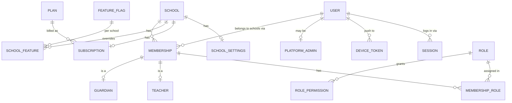
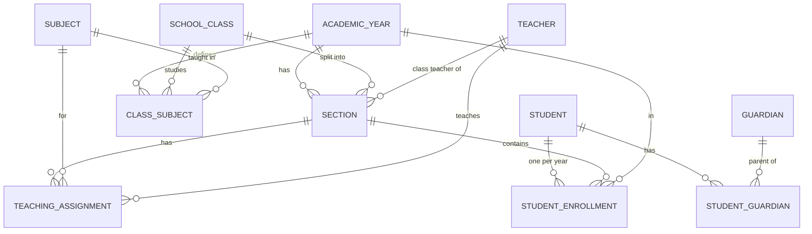
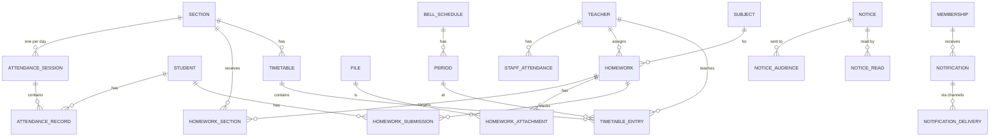
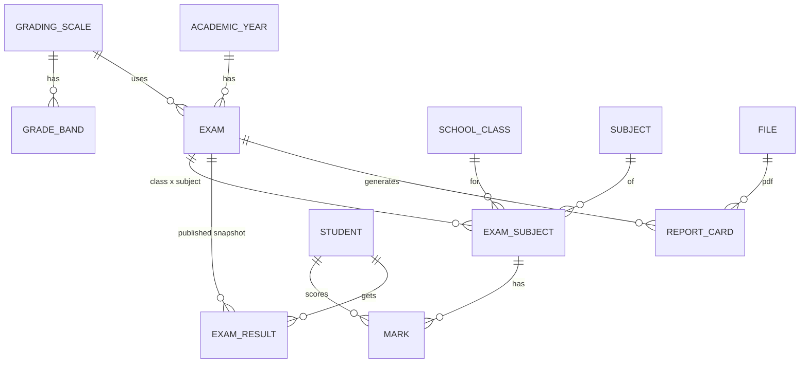

# 02 — Database Design

Source of truth: [`schema.prisma`](schema.prisma). It has 84 models and 51 enums, and it passes `prisma validate` on Prisma 7.10.
This document explains **why** it is shaped the way it is. ER diagrams are split by domain so they stay readable.
Every tenant table also has `school_id → schools.id`; that link is left out of the diagrams to reduce noise.

## 1. Modelling decisions

| # | Decision | Why |
|---|---|---|
| D1 | **One global `users` table + `memberships` per school** | A teacher at two schools or a parent with kids in two schools uses one login. Roles hang off the membership, not the user |
| D2 | `school_id` on **every** tenant row, even child rows (e.g. `attendance_records`) | RLS policies stay one-line and identical everywhere; no joins needed to decide tenancy |
| D3 | **`SchoolClass` is permanent, `Section` is per academic year** | "Class 8" exists forever; "8-A in 2026–27" is a yearly thing with its own class teacher and room |
| D4 | **`StudentEnrollment` (student × academic year)** | Promotion creates a new enrollment row; last year's class, roll no. and section are never overwritten (§28) |
| D5 | `Guardian` is per school, linked to a `Membership` once activated | School can record parents before they ever log in. One phone = one guardian per school |
| D6 | **Money is `Int` paise** | No floating-point errors. ₹21 lakh max per row is plenty for a single invoice/payment; reports aggregate as `bigint` |
| D7 | **Invoice lines are append-only**; corrections are `ADJUSTMENT` lines with a reason | "Never silently modify financial records" (§36). Invoice totals are cached on the invoice and updated in the same transaction |
| D8 | `Overdue` is **derived**, not stored | No nightly job needed to flip statuses; no drift |
| D9 | **Gap-free numbering** via `school_sequences` (row lock) | Indian schools expect continuous receipt/invoice numbers per year (`RCPT/2026-27/000456`) |
| D10 | Exam results are a **published snapshot** (`exam_results`) | Report cards and rankings must not change silently if marks are edited later; re-publish is explicit and audited |
| D11 | Grading scales are data (`grading_scales`, `grade_bands`) | No hard-coded CBSE/ICSE logic (§32) |
| D12 | `File` (storage object) separate from `Document` (business meaning) | Homework attachments, receipts, report cards and certificates all reuse one file pipeline |
| D13 | **Transactional outbox** (`outbox_events`) | Notifications/receipts can't be lost between DB commit and queue enqueue |
| D14 | `webhook_events` unique on `(provider, event_id)` | Duplicate Razorpay webhooks become no-ops |
| D15 | UUID v7 primary keys | Unguessable, index-friendly (time-ordered), safe to generate offline on mobile |
| D16 | Soft-archive (`archived_at`) for people; **never hard-delete** financial, attendance or marks rows | History and audit integrity; privacy deletion handled by a separate anonymisation procedure (09 §7) |
| D17 | School-configurable extra student fields → `students.custom_fields` JSON | Each board/state wants different fields (category, religion, UDISE no.) without schema changes |
| D18 | **Aadhaar numbers are not stored** in V1 | Aadhaar storage has its own legal rules. If needed later, store a masked/tokenised value only |

## 2. ER diagrams

### 2.1 Tenancy & identity



### 2.2 Academic structure & people



### 2.3 Daily operations



### 2.4 Exams



### 2.5 Fees & payments

```mermaid
erDiagram
  FEE_STRUCTURE ||--o{ FEE_STRUCTURE_CLASS : "applies to"
  FEE_STRUCTURE ||--o{ FEE_STRUCTURE_ITEM : "heads + annual amount"
  FEE_HEAD ||--o{ FEE_STRUCTURE_ITEM : is
  FEE_STRUCTURE ||--o{ FEE_INSTALLMENT : "due in"
  FEE_INSTALLMENT ||--o{ FEE_INSTALLMENT_SPLIT : splits
  FEE_STRUCTURE_ITEM ||--o{ FEE_INSTALLMENT_SPLIT : across
  STUDENT ||--o{ STUDENT_FEE_ASSIGNMENT : "assigned"
  FEE_STRUCTURE ||--o{ STUDENT_FEE_ASSIGNMENT : to
  CONCESSION_TYPE ||--o{ STUDENT_CONCESSION : grants
  STUDENT ||--o{ STUDENT_CONCESSION : receives
  STUDENT ||--o{ INVOICE : billed
  FEE_INSTALLMENT ||--o{ INVOICE : "generates"
  INVOICE ||--o{ INVOICE_LINE : "append-only"
  STUDENT ||--o{ PAYMENT : pays
  PAYMENT ||--o{ PAYMENT_ALLOCATION : "split across"
  INVOICE ||--o{ PAYMENT_ALLOCATION : "settled by"
  PAYMENT_GATEWAY_ACCOUNT ||--o{ GATEWAY_ORDER : creates
  GATEWAY_ORDER ||--o{ GATEWAY_ORDER_ITEM : "intended for"
  GATEWAY_ORDER ||--o{ PAYMENT : "captured as"
  PAYMENT ||--o| RECEIPT : has
  PAYMENT ||--o{ REFUND : may
  PAYMENT ||--o{ STUDENT_CREDIT : "excess becomes"
```

## 3. Fee model walkthrough (example)

```
FeeStructure "Classes 6–8 — 2026–27"  (applies to Class 6, 7, 8)
  Items:   Tuition ₹48,000 · Exam ₹2,000 · Transport ₹18,000 (optional)
  Installments: Q1 due 10 Apr · Q2 due 10 Jul · Q3 due 10 Oct · Q4 due 10 Jan
  Splits:  Tuition 12k/12k/12k/12k · Exam 1k/–/1k/– · Transport 4.5k × 4

Rahul (8-A) assigned this structure, opted Transport, has "Sibling 10% on Tuition" (approved)

Invoice INV/2026-27/000123 for Q1:
  FEE        Tuition Fee          12,000.00
  FEE        Exam Fee              1,000.00
  FEE        Transport Fee         4,500.00
  CONCESSION Sibling 10% tuition  -1,200.00
  ─────────────────────────────────────────
  Total                           16,300.00
After due date + grace: LATE_FEE line appended by the scheduled job (rule-capped).
```

Invoice generation is a background job ("Generate Q1 invoices for Classes 6–8") with a preview step showing
count and total before issuing.

## 4. Indexing strategy

- Every tenant table: composite indexes start with `school_id` (matches RLS predicate + typical filters).
- Hot paths:
  - `attendance_sessions (section_id, date)` unique — "today's register"
  - `attendance_records (school_id, student_id, date)` — student history, monthly %
  - `invoices (school_id, status, due_date)` — outstanding/overdue lists
  - `payments (school_id, received_at)` — daily collection
  - `notifications (membership_id, created_at desc)` — inbox
  - `timetable_entries (school_id, teacher_id, day_of_week)` — "today's classes"
- Search: `pg_trgm` GIN indexes (added by SQL migration) on student name, admission no., guardian phone,
  teacher name, invoice/receipt number. Postgres search is enough for V1; no Elasticsearch.

## 5. Migrations

- `prisma migrate dev` locally; `prisma migrate deploy` in CI as a Cloud Run Job **before** the new revision gets traffic.
- Things Prisma can't express live in hand-written SQL inside the migration folders:
  RLS policies, grants, trigram indexes, the audit-log write-only grant, partial unique indexes
  (e.g. `NULLS NOT DISTINCT` for platform-default templates).
- **Expand → migrate → contract** for breaking changes (add new column, backfill, switch code, drop old in a later release).
- A CI check fails if any model with `schoolId` lacks an RLS policy (03 §6).

## 6. Data volume estimate (per 1,000-student school per year)

| Table | Rows/year | Note |
|---|---|---|
| attendance_records | ~220,000 | 1,000 × ~220 school days |
| notifications | ~300,000 | dominated by absence + homework + notices |
| marks | ~40,000 | 1,000 × ~8 subjects × ~5 exams |
| invoices / payments | ~5,000 / ~5,000 | quarterly installments |
| audit_logs | ~100,000 | |

Even 100 schools × 5 years is ~110M attendance rows, fine for a single Postgres with good indexes.
Partition `attendance_records`, `notifications` and `audit_logs` by month **only when** they pass ~50M rows.

## Open questions

1. Admission number: does the school always type it in, or should we offer an auto sequence (`ADM/2026/0001`) with an override?
2. Is **daily** attendance enough for V1, or do any pilot schools need **period-wise** attendance? (The schema supports adding it later.)
3. Do we need a per-student fee **statement / ledger view** in V1? (It can be derived from invoices and payments; no extra table needed.)
