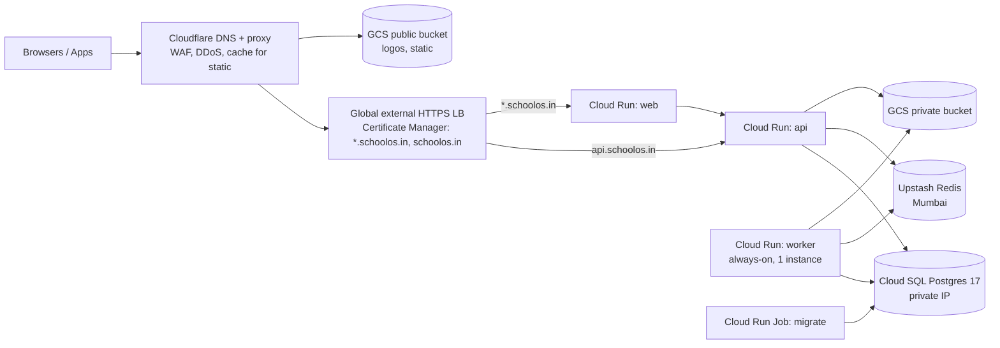
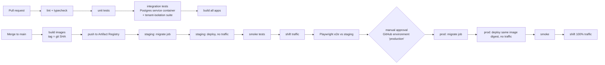

# 10 — Cloud Infrastructure Plan

Goals: production-grade for the first 10–15 schools, cheap while small, no rewrite needed to reach hundreds of schools.
Everything lives in **Google Cloud `asia-south1` (Mumbai)** unless noted.

## 0. Budget reality (updated 2026-10-07)

Available: **$300 Google Cloud free-trial credit, valid 3 months**. That is ~$100/month, and it expires before the
pilot (month 4–5). So:

1. **Months 1–3: local development only.** Don't spend credit on always-on infrastructure we don't need yet.
2. Use credit at the end for a **staging/pilot rehearsal** in *lean mode*:
   - Cloud Run api with **workers in the same process** (`RUN_WORKERS=true`), min instances 0 → 1 only when a school is live
   - Cloud SQL smallest shared-core tier, no HA
   - **No load balancer:** use the Cloudflare Worker routing option (§3, option B, $0–5)
   - Upstash free tier
   - Estimated **$25–45/month**
3. The full topology below is the target once paying schools exist. The code supports both: worker as a separate service
   or in-process, chosen by environment variable.
4. Set a **GCP budget alert at $50 / $80 / $100 per month**.
5. Once the company is registered, apply for the **Google for Startups Cloud Program** for larger credits.

## 1. Environments

| Env | Where | Data | Purpose |
|---|---|---|---|
| **local** | Your Mac, Docker Compose | Seeded fake data | Daily development |
| **staging** | GCP project `schoolos-staging` | Seeded demo data only, **never** real school data | Pre-release testing, sales demo (`demo.schoolos.in` lives in prod, see below) |
| **production** | GCP project `schoolos-prod` | Real schools | Live |

- Separate **GCP projects** per environment means separate IAM, secrets, databases and billing visibility.
- There is no always-on cloud "development" environment; local Docker covers it, which saves money.
- The demo school runs **in production** as a normal tenant (`demo` slug) with synthetic data, reset nightly, so sales always demos the real build.

### Local stack (`docker-compose.yml`)
| Service | Image | Replaces |
|---|---|---|
| Postgres 17 | `postgres:17` | Cloud SQL |
| Redis 7 | `redis:7` | Upstash |
| fake-gcs-server | `fsouza/fake-gcs-server` | Cloud Storage |
| Mailpit | `axllent/mailpit` | Email provider (view emails at localhost:8025) |
| (none) | console logger | SMS and push are logged locally, never sent |

Local hostnames: `*.localhost` resolves to 127.0.0.1 in browsers, so `stmarys.localhost:3000` works for subdomain testing without editing hosts files.

## 2. Production topology

### Services
| Component | Config (start) | Scales to |
|---|---|---|
| **Cloud Run `web`** (Next.js standalone) | 1 vCPU, 512 MiB, concurrency 80, min 1 (prod) / 0 (staging), max 10 | max-instances knob |
| **Cloud Run `api`** (NestJS) | 1 vCPU, 1 GiB, concurrency 80, min 1 (prod) / 0 (staging), max 20 | add instances; DB is the real limit |
| **Cloud Run `worker`** | 1 vCPU, 2 GiB (Chromium for PDFs), **instance-based billing (CPU always on)**, min 1, max 3 | split queues into separate services. Also evaluate **Cloud Run worker pools** (designed for pull-based workers like BullMQ) at setup time |
| **Cloud Run Job `migrate`** | runs `prisma migrate deploy` before each release | — |
| **Cloud SQL** Postgres 17, Enterprise edition | prod: 1 vCPU / 3.75 GB (`db-custom-1-3840`), 20 GB SSD auto-grow, private IP, PITR on. staging: smallest shared-core | 2–4 vCPU, read replica for reports, **HA** when paying schools justify it (doubles DB cost) |
| **Connection pooling** | Prisma pool of 5 per instance; cap total ≤ 60% of `max_connections` | Add PgBouncer (transaction mode; compatible with our `set_config(..., true)`) when instance count grows |
| **Cloud Storage** | `schoolos-prod-private` (uniform access, public-access prevention, versioning, 7-day soft delete); `schoolos-prod-public` (logos only) | — |
| **Upstash Redis** | Fixed-price plan in AWS `ap-south-1` (Mumbai). Use a **fixed plan, not pay-per-request**: BullMQ's polling burns commands even when idle | bigger plan, or Memorystore by changing one URL |
| **Secret Manager** | DB URLs, JWT keys, encryption master key, provider API keys | — |
| **Artifact Registry** | Docker images, cleanup policy keeps the last 20 | — |
| **Firebase** | FCM only (free), linked to the prod project | — |

### Network & access
- Cloud Run ingress for `web` and `api` is **"internal and Cloud Load Balancing"**, so the `*.run.app` URLs are not publicly reachable.
- Cloud SQL has a private IP only; Cloud Run reaches it via Direct VPC egress. No public DB IP.
- Each service runs as its own **service account** with least-privilege roles (api: SQL client, storage object admin on the private bucket, secret accessor for its own secrets).
- CI deploys via **Workload Identity Federation** (GitHub OIDC). There are no long-lived JSON keys.

## 3. Wildcard subdomains: the decision

Cloud Run domain mapping can't serve `*.schoolos.in`. Options:

| Option | Cost | Pros | Cons |
|---|---|---|---|
| **A. Google HTTPS Load Balancer + Certificate Manager wildcard cert** (recommended) | ~$18/mo + small data charge (credits) | Officially supported, one place for routing, hides run.app URLs, Cloud Armor available later | Slightly more setup |
| B. Cloudflare Worker proxy → Cloud Run URL | $0–5/mo | Cheapest | Extra hop, run.app must stay public (protected by a shared-secret header), more custom code |
| C. Host Next.js on Vercel | $20+/mo | Easiest wildcard | Leaves Google (credits unused), split hosting |

**Plan:** A. Cloudflare stays in front for DNS, DDoS protection, WAF rules and caching of static assets
(SSL mode **Full (strict)**; Certificate Manager DNS-authorisation CNAMEs added in Cloudflare).

## 4. Third-party services

| Service | Use | Action needed early |
|---|---|---|
| **MSG91** (or similar DLT-compliant gateway) | OTP + transactional SMS | ⚠️ **DLT registration takes 1–3 weeks:** register your company as the principal entity, a sender ID header (e.g. `SCHLOS`), and every SMS template. Start in Phase 1 |
| **Resend** or **Brevo** | Transactional email | Verify domain `mail.schoolos.in` (SPF, DKIM, DMARC). From name = school name |
| **Firebase Cloud Messaging** | Push | Firebase project + APNs key (needs an Apple Developer account, $99/yr, at Phase 7) |
| **Razorpay** | Each school's own account | A test-mode account for us (development) |
| **Sentry** | Errors + performance | Free/Team plan; data region per Sentry offering (only scrubbed, non-PII events) |
| **Google Play / Apple App Store** | Mobile apps | Developer accounts at Phase 7 (Play $25 one-time, Apple $99/yr) |

## 5. CI/CD (GitHub Actions)

- The **same image digest** is promoted from staging to prod; no rebuilds.
- Rollback = shift traffic back to the previous revision (seconds). DB migrations are backward-compatible (expand/contract), so rollback is safe.
- Turborepo remote cache keeps CI fast.
- Mobile (Phase 7): GitHub Actions + fastlane, or Codemagic, builds to TestFlight / Play internal testing.

## 6. Backups & disaster recovery

| Layer | Setting |
|---|---|
| Cloud SQL automated backups | Daily, **retain 30**, plus **point-in-time recovery** (7 days of transaction logs) |
| Weekly logical export | `pg_dump` (Cloud Run Job) → GCS bucket in **`asia-south2` (Delhi)**, retain 12 weeks, so a copy survives a Mumbai region outage |
| GCS files | Object versioning + soft delete (7 days); critical prefixes (receipts, report cards) replicated to Delhi monthly |
| Secrets | Secret Manager versions retained; encryption master key has an offline escrow copy (2 people) |
| Targets | **RPO ≤ 5 min** (PITR), **RTO ≤ 4 h** for a full restore |

**Restore drills (mandatory):** monthly, restore the latest backup to a temporary instance, run `scripts/verify-restore`
(row counts per table, latest payment/receipt checks, RLS policies present), record the result in
`docs/runbooks/restore-log.md`, then delete the instance. **A backup that has never been restored doesn't count.**

Runbooks to write in Phase 1: restore DB, rotate secrets, incident response (incl. CERT-In 6 h), gateway outage, SMS provider outage.

## 7. Monitoring & alerting

| Signal | Tool | Alert when |
|---|---|---|
| API/web/worker exceptions | Sentry | new issue; error spike |
| API latency | Cloud Monitoring (Cloud Run metrics) | p95 > 800 ms for 10 min |
| 5xx rate | Cloud Monitoring | > 1% for 5 min |
| Uptime | Uptime checks: `/health` on api, web, `demo.` | 2 consecutive failures |
| Database | Cloud SQL metrics | CPU > 80% 15 min, storage > 80%, connections > 80% |
| Queues | Worker exports metrics (waiting, failed, DLQ size) as log-based metrics | DLQ > 0; waiting > 1,000 for 10 min |
| Payments | Log-based metric | webhook signature failures > 0; captured-but-unallocated > 0; reconciliation mismatch |
| Notifications | Delivery table metric | SMS/push failure rate > 5% |
| Auth | Log-based metric | login failures spike; OTP send spike (pumping) |
| **Cost** | GCP Budgets | 50% / 90% / 100% of the monthly budget (protects credits) |

Logs: structured JSON (pino) → Cloud Logging, kept 180 days in an India-located log bucket.
Super Admin → System shows queue stats and DLQ, with retry/discard.

## 8. Monthly cost estimate (rough, verify with the GCP pricing calculator)

| Item | Staging | Production |
|---|---|---|
| Cloud Run web + api (min 1 each in prod) | ~$0–5 | ~$25–50 |
| Cloud Run worker (always on, 1 vCPU / 2 GiB) | ~$0–10 (min 0) | ~$45–60 |
| Cloud SQL | ~$10 (shared core) | ~$55–65 (zonal) · ~$110–130 with HA |
| Load balancer | — (staging uses run.app + Cloudflare Worker, or shares prod LB) | ~$18–25 |
| Cloud Storage + egress | ~$1 | ~$2–10 |
| Upstash Redis (fixed plan) | ~$10 | ~$10–20 |
| Logging/monitoring | free tier | ~$0–10 |
| **Google subtotal** | **~$20–40** | **~$150–230** |
| Sentry | free | $0–26 |
| SMS (usage) | — | ~₹0.15–0.25 per SMS (+DLT fees); pass through in plans |
| Email | free tier | $0–20 |

With credits this is mostly covered. After credits, cost levers are: worker on a small VM or worker pool, HA only for paying tiers, and staging scaled to zero.

## 9. Scaling path (when, not now)

| Trigger | Action |
|---|---|
| p95 latency up from DB CPU | Upgrade Cloud SQL tier; add read replica for reports |
| > ~30 Cloud Run instances | PgBouncer |
| Big tables > 50M rows | Monthly partitions (attendance, notifications, audit) |
| Heavy PDF/report load | Separate `worker-docs` service |
| Search gets slow | Postgres FTS tuning, then a search service only if needed |
| Enterprise customer needs isolation | Dedicated Cloud SQL instance for that school (the app supports per-tenant DB URL routing later) |

## Open questions

1. ~~Budget~~ → $300 trial for 3 months; alerts at $50/$80/$100 (decided 2026-10-07).
2. Choose email provider: **Resend** (simpler developer experience) or **Brevo** (cheaper at volume, Indian billing)?
3. Is your company registered (needed for DLT SMS registration, Razorpay test account, app store accounts)?
