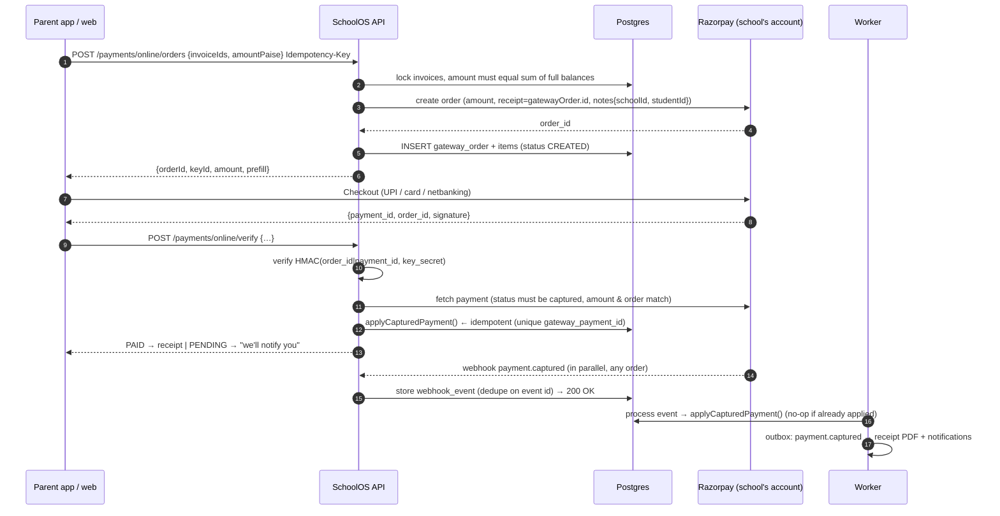

# 11 — Fees & Payments Design

Fees are the module schools judge us on. The rules below aim for **zero lost payments and zero double-counted payments**.

## 1. Principles

1. **Money goes to the school's own Razorpay account.** SchoolOS never holds funds, so it is not a payment aggregator.
2. **The client is never trusted.** A payment counts only after server-side verification (signature + API fetch) or a verified webhook.
3. **Captured money is never rejected.** If it can't be allocated (invoice already paid, order expired), it becomes a **student credit**, not an error.
4. **Financial rows are append-only.** Fix mistakes with adjustments, voids and refunds, each with a reason and an audit entry.
5. **Every money-moving request is idempotent.**

## 2. Connecting a school's Razorpay account

```
Settings → Payment gateway
1. School admin pastes Key ID + Key Secret (Test mode first)
2. We verify the keys with a read-only Razorpay API call → "Connected ✓"
3. We generate a strong webhook secret and show:
     Webhook URL:  https://api.schoolos.in/v1/webhooks/razorpay/{publicId}
     Secret:       ••••••••  [Copy]   (shown once)
     Events:       payment.authorized, payment.captured, payment.failed,
                   order.paid, refund.processed, refund.failed
   The admin adds it in their Razorpay dashboard (step-by-step guide with screenshots in-app)
4. "Make a ₹1 test payment" in Test mode → webhook received → "Webhook verified ✓"
5. Switch to Live: repeat with live keys. Online payments for parents turn on only when Live is verified.
```

- Secrets are encrypted at rest (09 §3) and **never** shown again or returned by the API.
- The account must have **auto-capture** enabled. As a safety net, `payment.authorized` events trigger a capture API call.
- V1.1 idea: Razorpay partner OAuth, so schools connect with one click and webhooks are set up automatically.

## 3. Online payment flow (parent)



### `applyCapturedPayment()` (one DB transaction, tenant-scoped)
1. `INSERT payment (gateway_payment_id UNIQUE)`. If that conflicts, it was already applied: return the existing one.
2. `SELECT … FOR UPDATE` the order's invoices.
3. Allocate in order of the order items, each capped at the invoice's **current** balance.
4. Any remainder goes to a `student_credit` (e.g. two tabs paid the same invoice).
5. Update invoice `paid/balance/status` and `version`.
6. Take the next receipt number from `school_sequences` (row lock) and create the `receipt`.
7. Write `audit_log` and `outbox_event('payment.captured')`.
8. Commit. After commit, the receipt PDF and notifications run in the worker.

## 4. Failure and edge cases

| Case | Handling |
|---|---|
| Parent closes app after paying, before `/verify` | Webhook applies it; reconciliation job is the second safety net |
| Webhook arrives before `/verify` | Fine, both paths call the same idempotent function |
| Duplicate webhooks | `webhook_events (provider, event_id)` unique → second one ignored |
| Webhook never arrives | **Reconciliation job** every 10 min: orders `CREATED/ATTEMPTED` older than 15 min and younger than 72 h → fetch the order's payments from Razorpay → apply |
| Payment failed | `payment.failed` → order `ATTEMPTED`; parent sees "No money was taken. Try again"; no invoice change |
| UPI pending (bank delay) | Parent sees "Pending with your bank"; webhook/reconcile settles it later; notification on success |
| Invoice paid at the counter while the parent is mid-checkout | Online capture still succeeds; the allocation finds zero balance, so the money goes to student credit and the accountant sees a "Credit available: refund or adjust" task |
| Order amount tampering | Server fetches the payment and compares the amount and order id with our `gateway_order`; mismatch → flag, no allocation, alert |
| Signature invalid on `/verify` | 400, logged as a security event; webhook/reconcile remain the authority |
| Webhook with bad signature | 401, stored with `signature_valid=false` for investigation, alert |
| Razorpay down | Order create fails → 503 "Online payment is temporarily unavailable. You can pay at the school office." Circuit breaker; status shown in app |
| Our API down during webhook | Razorpay retries webhooks; plus reconciliation |
| Partial payment attempt | **Not supported (decided 2026-10-07).** Parent selects whole invoices; order amount = sum of their full balances. Server rejects any other amount |
| Late fee added while order open | Order amount is fixed; any shortfall stays as balance on the invoice |
| Wrong school credentials (keys rotated) | Order create fails → admin alert "Payment gateway disconnected" |

## 5. Counter (offline) payments

- Methods: Cash, UPI to the school account, bank transfer, card (POS). **No cheque/DD and no partial payments** (decided 2026-10-07): a counter payment settles whole invoices.
- `POST /payments/collect` with an `Idempotency-Key`. Same allocation function and receipt numbering as online.
- **Void** (counter payments only, `payment.void` permission): reverses allocations with negative allocation rows, marks the receipt cancelled (its number is never reused), and records reason + audit. Online payments can't be voided, only refunded.
- Accountant's **day close**: a collection summary by method and by collector, which can be printed and handed over with cash.

## 6. Refunds

- `POST /payments/:id/refunds {amountPaise, reason}`, requires `payment.refund`, with an idempotency key.
- Source of refund:
  1. Student credit first (excess money), or
  2. Against invoices: negative allocations reopen those invoice balances (reason required).
- Online: call the Razorpay refund API → `PENDING` → `refund.processed` / `refund.failed` webhook → update status.
- Counter payments: refund recorded as a manual outflow (cash/bank) with reference.
- Parent is notified on refund processed.

## 7. Invoices

- Generated in bulk per installment for selected classes. Shows a **preview** (count, total, sample) before issuing. Runs as an async job.
- Lines are built from the structure items' installment splits, minus approved concessions (sibling, scholarship, …), plus optional heads the student opted into.
- Issued invoices are **immutable** except for:
  - appended `ADJUSTMENT` lines (reason, permission `invoice.adjust`)
  - appended `LATE_FEE` lines (scheduled job, rule-based, capped, idempotent per invoice per day)
  - cancellation (`invoice.cancel`, only if no allocations; otherwise refund/void first)
- Numbering: `INV/2026-27/000123`, gap-free per school per academic year.
- Overdue = `due_date + grace < today AND balance > 0` (computed).

## 8. Receipts

- Number `RCPT/2026-27/000456`, gap-free, per school per academic year; cancelled receipts keep their number.
- PDF (generated in the worker with Chromium from an HTML template) includes: school logo and name, address, contact,
  receipt no., date, student name, admission no., class-section, guardian, fee lines paid (head-wise), amount in figures
  and words (Indian system), payment method and reference / gateway transaction id, collector (counter),
  "Computer generated receipt" footer, optional signature image.
- Downloaded via signed URL, sent to the parent by push/in-app (and email if available). Reprints are marked "Duplicate".

## 9. Reminders & late fees (scheduled, per school, idempotent)

| Job | When | Action |
|---|---|---|
| Due reminder | N days before due (school setting, e.g. 7 and 1) | Push + SMS (if enabled) to guardians with `receives_notifications` |
| Overdue reminder | Weekly while overdue (max N times) | Push; SMS on first and last |
| Late fee | Daily 00:30 school time | Append `LATE_FEE` line per rule (flat once, or per day up to a cap) |
| Reconciliation | Every 10 min | Section 4 |
| Daily reconciliation report | 06:00 | Compare Razorpay captured payments (yesterday) with ours; mismatches go to the Accountant + Super Admin alert |

## 10. Finance reports (V1)

Daily collection (by method, collector, head) · Outstanding by class/section · Defaulters list (with export and bulk reminder) ·
Head-wise collection · Concessions given · Online payment reconciliation · Refunds · Student fee statement (invoices + payments + credits).

Settlement reconciliation (Razorpay payouts → bank UTR) is **V1.1**.

## 11. Tests (must exist before go-live)

- Signature verification (valid, tampered body, wrong school secret)
- Duplicate webhook, webhook-before-verify, verify-before-webhook, neither (reconcile)
- Concurrent captures on the same invoice → one allocation plus credit, never a negative balance
- Idempotent counter collection (double submit)
- Void and refund reopen balances correctly; receipt numbers stay gap-free under concurrency
- Amount mismatch is flagged, not allocated
- Cross-tenant: School A's webhook URL with B's payload/secret is rejected

## Open questions

1. **Convenience fee:** should schools be able to pass the gateway fee on to parents? Default is off (school absorbs it). There are legal and Razorpay-policy nuances; confirm before enabling.
2. ~~Partial payments~~ → **not allowed** (decided 2026-10-07).
3. ~~Cheque handling~~ → **no cheque/DD** (decided 2026-10-07).
4. Any pilot school requirement for **GST invoices** (e.g. transport via a third party)? Core school tuition fees are generally GST-exempt, but confirm with an accountant.
